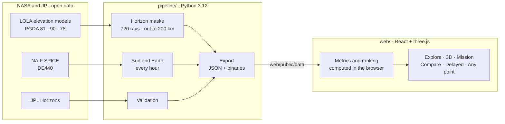
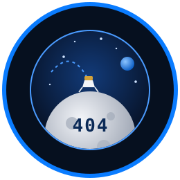

<p align="center">
  
</p>

<h1 align="center">Lunar Landing Site Navigator</h1>

<p align="center">
  <b>Light and a line to Earth, hour by hour, for 17 landing sites at the lunar south pole.</b><br>
  NASA Space Apps Challenge 2026 · Team Apolo404 · Sogamoso, Colombia
</p>

<p align="center">
  <a href="https://ivangomezgb.github.io/LUNAR-SIGHT/"></a>
  <a href="https://apolo404-alunizaje.vercel.app/"></a>
  <a href="https://www.spaceappschallenge.org/"></a>
</p>

<p align="center">
  <a href="https://github.com/ivangomezgb/LUNAR-SIGHT/actions/workflows/deploy.yml"></a>
  
  
  
  
  <a href="LICENSE"></a>
</p>

---

Near the lunar south pole the Sun never climbs high: it circles the horizon a few degrees up, so a
ridge a few metres tall decides whether a lander has power and whether it can see the Earth to talk
home. This static web app answers one question, **hour by hour and for every candidate site: is the
Sun up, and is the Earth in view?**

It covers **17 sites**: all nine NASA Artemis III candidate regions of 2024, four more from the 2022
list, Shackleton's rim and the IM-2 *Athena* landing point. It shows the **real horizon** seen from
the ground with the paths of the **Sun and Earth**, computes **power (sunlight) and communications
(Earth visibility)** metrics through 2028, shows each site **in 3D and as an immersive 360° view**,
recommends **other sites and dates when a mission slips**, and lets you **fly, land and drive a rover**
on the real terrain.

Every number comes from public NASA and JPL data: LOLA elevation models (PGDA) for the terrain, NAIF
SPICE (DE440) for the Sun and Earth, LOLA error clones for terrain uncertainty and USGS navigation
grids for the newest regions, validated against JPL Horizons.

## At a glance

<table>
  <tr>
    <td align="center" width="25%"><br><b>17</b><br><sub>candidate landing sites</sub></td>
    <td align="center" width="25%"><br><b>720</b><br><sub>directions per horizon, one every 0.5°, out to 200 km</sub></td>
    <td align="center" width="25%"><br><b>19 008</b><br><sub>hourly Sun and Earth positions, Nov 2026 – Dec 2028</sub></td>
    <td align="center" width="25%"><br><b>0.000027°</b><br><sub>largest error vs JPL Horizons (threshold 0.05°)</sub></td>
  </tr>
</table>

## The tour: nine stops

The app is built as a route. A built-in explorer guide takes first-time visitors through every tab,
each page shows its stop number, and each one ends with a link to the next stop.

| | Stop | What you do there |
| :---: | --- | --- |
|  | **1 · Explore** | Polar map of the 17 sites. Pick one to see a 2D 360° panorama: real horizon, Sun path (gold, solid) and Earth path (blue, dashed), animated through time. Eight metric cards (sunlight with its p5–p95 terrain-uncertainty band), a 30-day timeline, the **landing light risk** card, an **energy and night-survival** simulation (editable panel, loads and battery), a **slope map with the safe landing area** (10 m LOLA grid), the **nearest permanently shadowed regions** (official LOLA PSR map) and a printable **mission brief**. Site and time live in the URL (`#/?site=connecting-ridge&t=2027-01-12T06:00Z`). |
|  | **2 · 3D** | Three ways to look at a site with one time slider (`t=`, `days=` 1/14/30): **3D overview** (real LOLA terrain lit by the real Sun with cast shadows and a sky dome with the real Sun and Earth paths), **First person · 2 m** and **Astronaut 360°** (precomputed panorama whose horizon matches the mask within 0.2°). |
|  | **3 · Play mission** | A full-screen educational game on the real data. Your ship hops between the 17 sites over a 3D Moon (NASA LROC colour + LOLA relief) with the Earth and Sun at their real directions; land with the main engine, then drive a solar rover where sunlight and the Earth link are computed at the rover. Lunar gravity (1.62 m/s²) sets the climb (~17°) and slide (~24°) limits, the electronics freeze below −40 °C without the heater, the panel follows the real Sun angle and dust flies on ballistic arcs. Six objectives teach polar-site science; the report compares your run with the site's published metrics. Game numbers are declared assumptions. |
|  | **4 · Compare** | Up to three sites side by side for the same date: panoramas, aligned timelines, metrics with the best value highlighted, landing light risk and uncertainty band. |
|  | **5 · Mission delayed** | Enter the original site and date, the delay and a tolerance: every site × landing time (6 h steps) is scored with adjustable weights and hard filters. Top 10 with their three main reasons, in well under a second in the browser. |
|  | **6 · Any point** | Pick any point of the south-polar map or type coordinates. The browser computes an **approximate** horizon from coarse LOLA grids (240 m + 960 m) and runs every metric, the landing risk and a 3D view, compared with the nearest curated site. Its measured accuracy is shown on the page. |
|  | **7 · Validation** | Our Sun/Earth positions vs JPL Horizons, our visibility vs the published LOLA long-term maps (Mazarico et al. 2011) at all 17 sites, the IM-2 *Athena* landing and every assumption. |
|  | **8 · About** | A scroll story: one real lunar day at Connecting Ridge played by scrolling, the five-step method, the validation results, sources, limitations and use of AI. |
|  | **9 · Apolo404** | The team, from Sogamoso to the lunar south pole. |

English and Spanish (`?lang=es`); observer and panel height 1, 2, 5 or 10 m (`?h=`).

## How it works



| | Step | Detail |
| :---: | --- | --- |
|  | **Terrain** | LOLA 5 m/px (PGDA 81) or 10 m/px (PGDA 90) out to 7.5 km, 20 m/px to 60 km and 240 m/px to 200 km. |
|  | **Horizon** | Rays every 0.5° of azimuth with exact spherical geometry; the highest terrain angle in each direction, from 1, 2, 5 and 10 m. |
|  | **Sky** | Apparent Sun and Earth positions in `MOON_ME` (DE440), hourly from 2026-11-01 to 2028-12-31, turned into local azimuth and elevation. |
|  | **Light and link** | Visible fraction of the solar disk (radius 0.267°) above the real horizon; the Earth counts when its centre is ≥ 0.5° above it. |
|  | **In your browser** | Metrics, the delayed-mission ranking, the 3D views and the game run client-side from the exported files. The same metrics exist in Python (`lln/metrics.py`) and a test checks parity. |

More detail:

- **Site points**: published reference points (e.g. the centre of each Artemis III region) often sit
  on steep slopes. `pipeline/scripts/refine_sites.py` moves each site to the best-lit point with slope
  ≤ 8° within 1 km of its reference; the reference and the rule are shown in the app. The IM-2
  *Athena* site is never moved. Peak near Cabeus B and Slater Plain start from the centre of their
  official USGS navigation grid (`pipeline/scripts/usgs_region_center.py`).
- **3D and 360°**: local tangent-plane heightmaps (curvature included) and an equirectangular
  distance/normal panorama from 2 m, both lazy-loaded (`docs/contracts-3d.md`).
- **Uncertainty**: the near-field horizon is recomputed on 30 full-surface LOLA error clones per site,
  in GitHub Actions, one parallel job per site (`.github/workflows/uncertainty.yml`).

<details>
<summary><b>Repository layout</b></summary>

```
pipeline/ (Python)                                   web/ (TypeScript, Vite + React)
  config/sites.yaml   curated sites + sources          src/lib/       metrics, ranking, risk, free point
  lln/dem.py          LOLA tiles by HTTP range          src/components panorama, map, timeline, 3D…
  lln/horizon.py      multi-scale horizon (numba)       src/pages/     Explore, 3D, Compare, Replan…
  lln/ephem.py        Sun & Earth with SPICE            src/game/      mission: sim (pure TS) + render
  lln/terrain.py      3D heightmaps (near + far)        src/guide/     explorer guide and tour
  lln/pano.py         360° distance + normal images
  lln/uncertainty.py  LOLA clone ensembles
  lln/illum_map.py    yearly light / Earth map per cell
  lln/freepoint.py    coarse grids + Sun/Earth vectors
  lln/validate.py     JPL Horizons comparison   ──JSON/binaries──▶  web/public/data/
  lln/export.py       sites.json, sites/<id>.json, basemap
```

</details>

## Metrics

All metrics come from one hourly question: *what fraction of the solar disk is above the real
horizon, and is the Earth up?*

| Metric | Definition |
| --- | --- |
| Sunlight | mean visible fraction of the solar disk (radius 0.267°) over the mission window, % |
| Longest day / night | longest run of hours with ≥ / < 0.5 of the disk visible |
| Earth visible | % of hours with the Earth's centre ≥ 0.5° above the real horizon |
| Hours to sunset / Earthset | from the chosen time to the next loss of Sun / Earth |
| Next Earth window | start and duration of the next continuous Earth visibility |
| Sun at landing | Sun elevation above the real horizon at the landing hour |
| Terrain uncertainty | p5 / p50 / p95 of 2027 sunlight over 30 LOLA error clones (PGDA 78), 14 of 17 sites |
| Landing light risk | Sun margin above the 2 m mask, sunlight and Earth time remaining, shadow lengths, low / medium / high |
| Energy and night survival | hourly solar generation of a vertical panel from the real visible-disk series, battery state of charge, depletion time and the minimum battery that survives the mission |
| Slopes and safe area | slope from the 10 m LOLA grid (curvature removed), % of the 50–500 m circles ≤ 8° and ≤ 15°, nearest 100 m circle entirely ≤ 8° |

Thresholds are assumptions, shown and editable in the UI and listed in [`docs/assumptions.md`](docs/assumptions.md).

## Validation

| | Check | Result |
| :---: | --- | --- |
|  | Sun and Earth vs JPL Horizons, 3 sites × 10 instants × 2 bodies | max error **1.05e-6°** in azimuth and **2.68e-5°** in elevation (threshold 0.05°) |
|  | Sun / Earth visibility vs the LOLA long-term maps (Mazarico et al. 2011), same definition, 17 sites | Earth **r = 0.984** (median 2.4 pp); Sun **r = 0.914** (higher where our site sits on a best-lit peak) |
|  | IM-2 *Athena* landing, 6 March 2025 | Sun **2.47°** above a **0.83°** horizon: fully up |
|  | 360° panoramas vs the horizon masks | within 0.2° in 100 % of columns for 16 of 17 sites |
|  | Horizon algorithm vs analytic cases (smooth Moon, walls) | coordinate round trips < 1 m |
|  | Any point (coarse DEM) vs the curated masks | mean 0.25°, max 2.64°; sunlight within 1.25 pp on average |

Details in [`docs/validation.md`](docs/validation.md).

## Run it

```bash
# pipeline (Python 3.12)
pip install -r pipeline/requirements-dev.txt
python pipeline/scripts/download_kernels.py
python pipeline/run_all.py                    # first run downloads ~1.5 GB of LOLA tiles (cached)
python pipeline/run_all.py --terrain --pano   # 3D heightmaps and 360° panoramas
python -m pytest pipeline/tests

# web (Node 20+)
cd web
npm ci
npm run dev                                   # http://localhost:5173
npm test
npm run build                                 # static site in web/dist
```

The generated data in `web/public/data/` is committed, so the web app builds without running the
pipeline. Pushing to `main` runs the tests, validates the data (`pipeline/scripts/check_data.py`) and
deploys to GitHub Pages (`.github/workflows/deploy.yml`) and Vercel (`vercel.yml`).

## Data and references

- LOLA DEMs: [PGDA 81](https://pgda.gsfc.nasa.gov/products/81) (5 m/px, 87°S), [PGDA 90](https://pgda.gsfc.nasa.gov/products/90) (10/20/240 m/px), [PGDA 78](https://pgda.gsfc.nasa.gov/products/78) (site DEMs and error clones)
- [NAIF SPICE generic kernels](https://naif.jpl.nasa.gov/pub/naif/generic_kernels/) (DE440, lunar orientation)
- [JPL Horizons API](https://ssd-api.jpl.nasa.gov/doc/horizons.html)
- Artemis III candidate regions: [NASA App Development Challenge 2023 data](https://www.nasa.gov/learning-resources/app-development-challenge/2023-handbook-and-coding-components) and the USGS LGRS navigation grids, McClernan (2024), [doi:10.5066/P1MEQ6UK](https://doi.org/10.5066/P1MEQ6UK)
- IM-2 *Athena* landing point: [LROC](https://lroc.im-ldi.com/images/1408)
- LOLA polar illumination and PSR maps: [PGDA 69](https://pgda.gsfc.nasa.gov/products/69) (Mazarico et al. 2011, doi:10.1016/j.icarus.2010.10.030)
- Global Moon textures of the 3D globe (context only): [NASA SVS CGI Moon Kit](https://svs.gsfc.nasa.gov/4720)
- Bussey et al. (2010), *Icarus* 208; Mazarico et al. (2011), *Icarus* 211 — south-pole illumination; Barker et al. (2021), *PSS* — LOLA site DEMs and clones
- Every site's source is in [`pipeline/config/sites.yaml`](pipeline/config/sites.yaml)

## Team Apolo404

<table>
  <tr>
    <td width="200" align="center"></td>
    <td>
      <b>Brayan David López Castellanos</b> · Systems Engineering, UPTC Sogamoso<br>
      <b>Ashly Andrea Osorio Márquez</b> · Systems Engineering, UPTC Sogamoso<br>
      <b>Rafael Esteban Lozano Vargas</b> · Systems Engineering, UPTC Sogamoso<br>
      <b>Juan Esteban Vargas González</b> · Systems Engineering, UPTC Sogamoso<br>
      <b>Iván Leonardo Gómez</b> · Software Analysis and Development Technologist, SENA<br><br>
      <i>Apolo404 — limits not found.</i>
    </td>
  </tr>
</table>

## Use of AI

This project was built with AI coding agents, as allowed by the challenge guidelines:
**Claude Code** (Anthropic) coordinated the work, wrote the pipeline, the UI and the integration and
reviewed every change, and **OpenAI Codex** (GPT-6 models) wrote the execution plan
([`docs/execution-plan-codex.md`](docs/execution-plan-codex.md)), the metrics/ranking engine and
parts of the 3D, design and extras work. Commits written with AI say so. Every number was checked
against tests or independent references; see Validation.

## License

[MIT](LICENSE). NASA data is public domain; please cite the original data products.
